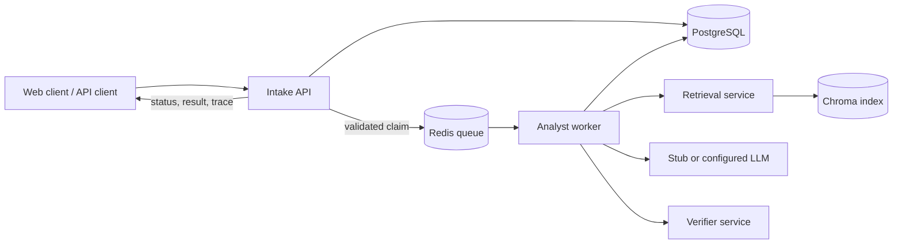

# Architecture

The service accepts a claim through the web client or API, validates and queues it, then processes it asynchronously. The worker retrieves policy wording, drafts a recommendation, and sends the result to a separate verifier before storing the run, trace, and citations.

## Service topology

## Deployment boundaries

| Boundary | Reason for separation |
|----------|-----------------------|
| API | Scales with request rate and remains available while workers are busy or restarting. |
| Worker | Scales with agent load (`--scale worker=3`); a worker failure does not take down intake. |
| Verifier | Runs as a separate service so verification has an independent process boundary. |
| Retrieval | Holds the embedding model in memory; keeping it outside scaled workers avoids multiplying model memory. |
| Redis, PostgreSQL, and Chroma | Stateful services have separate lifecycle and persistent volumes. |
| Stub LLM | Test provider used for local development and failure simulation. |

## Run states

`queued` → `analysing` → `verifying` → `completed`, `escalated`, `degraded`, or `failed`.

A failed run does not carry a coverage position.
